<!-- Generado por scripts/render_profile.py a partir del diseño del perfil. No editar a mano: edita el script y vuelve a ejecutarlo. -->

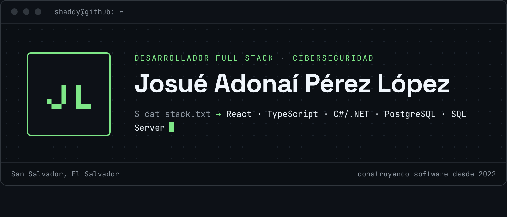 
<a href="#sobre-mi">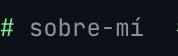</a><a href="#experiencia">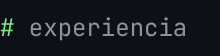</a><a href="#proyectos">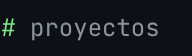</a><a href="#stack">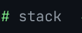</a><a href="#orgs">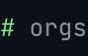</a> 
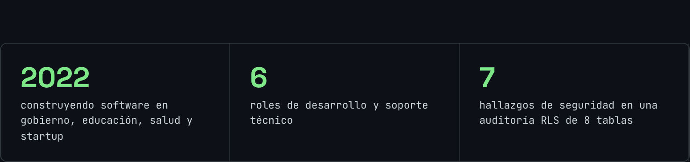 
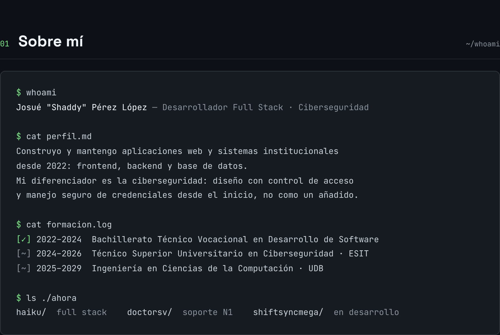 
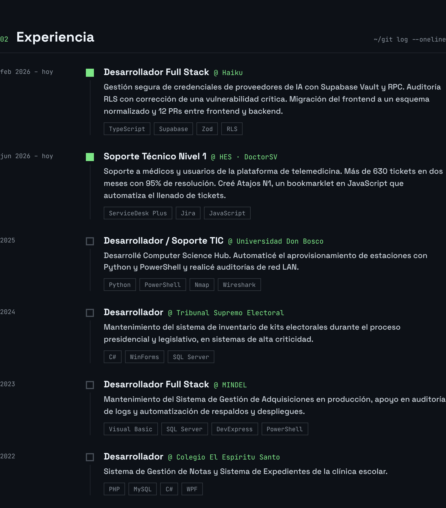 
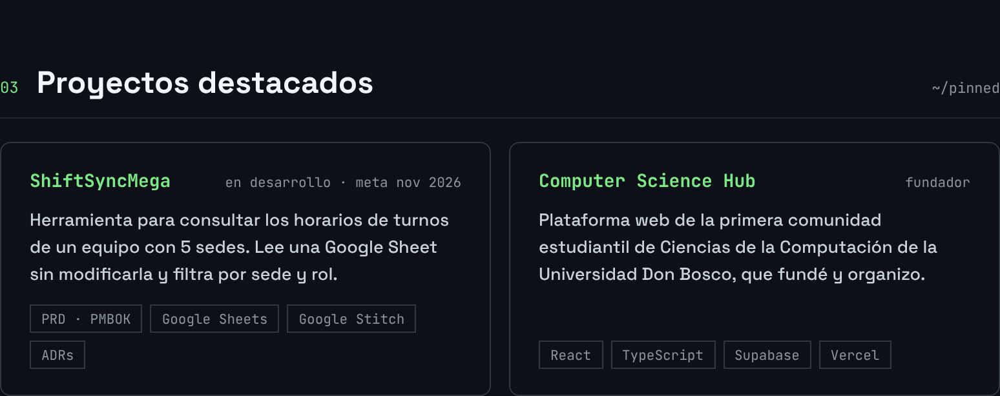 
 
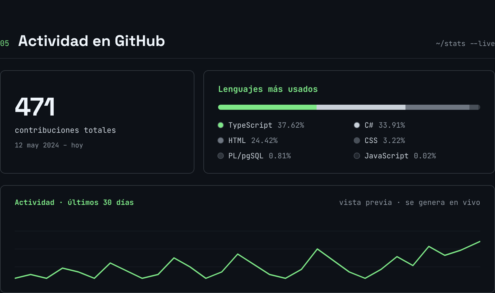 
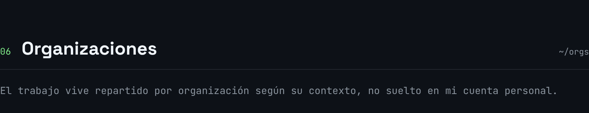 
<a href="https://github.com/software-insight">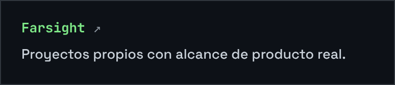</a><a href="https://github.com/doctor-sv">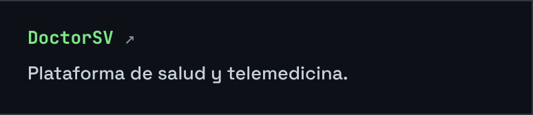</a> <a href="https://github.com/Computer-Sciencie-Hub">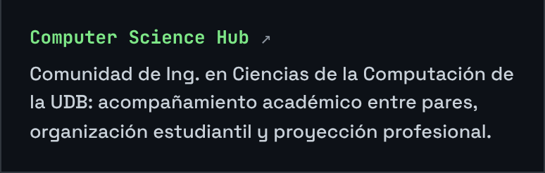</a><a href="https://github.com/udb-sv">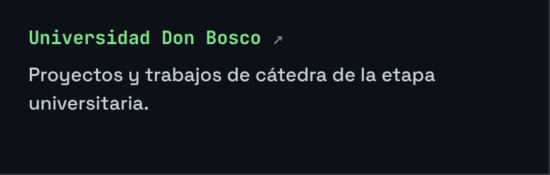</a> <a href="https://github.com/cees-sv">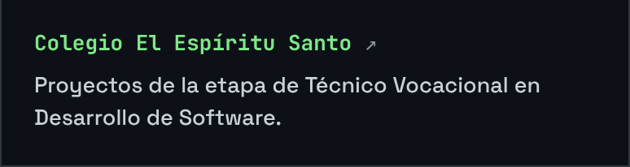</a><a href="https://github.com/delirios-creativos">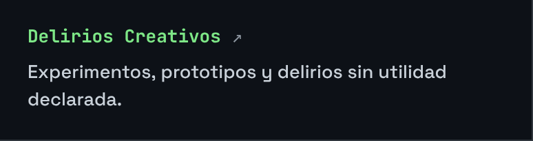</a> 
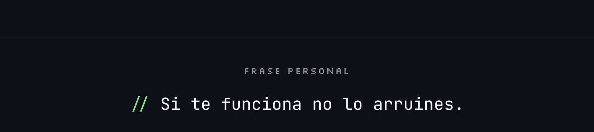

<a href="https://www.linkedin.com/in/josu%C3%A9-adona%C3%AD-p%C3%A9rez-l%C3%B3pez-6666193a8">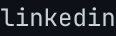</a>

